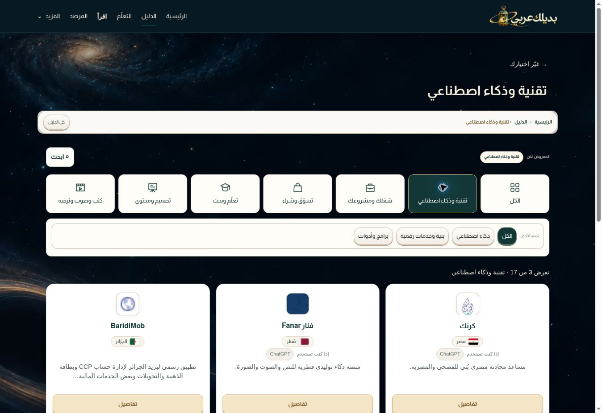

# Directory visible choices — 2026-10-12

## Scope and decision
User requested visible category icons and internal choices in the separate directory view, with corrected transitions. Keep existing copy, data, card actions, identity, space background and prelaunch restrictions. Conditional permission to improve cards does not require redesign: their existing presentation remains unchanged.

## Implementation
- 25a8748: expose seven category buttons with decorative SVG icons; show the relevant subfilters immediately. Search remains collapsible. Update pressed states and preserve category/subcategory selection in browser history; All stays at /#directory.
- 1f202853: complete the previously staged mobile spacing adjustment, keeping search beside context when space permits and making the active subfilter clearly distinct.
- Production deployment dpl_7dttqzawPUACQTcYX3HXUDJBgjkY reached READY.

## Verification actually performed
- Build and known-service journey audit passed after the final CSS commit.
- Earlier in this same scoped round: human-experience, prelaunch and directory-rotation audits, JavaScript syntax and diff checks passed.
- Live browser: tech/AI -> work -> Back restored tech/AI -> Back restored tech/all. No horizontal overflow in those desktop states.
- Live browser: All navigates to /#directory and remains the directory after reload.
- Final desktop screenshot shows all category icons, relevant subfilters and unchanged card presentation.
- Final mobile viewport screenshot at /category/tech?sub=ai visually checked: two-column categories, visible subfilters, compact context/search row, no visible overlapping controls. This is a visual check, not a full mobile interaction or performance test.

## Protected semantic content
82 service identities/order, 36 learning records, 20 articles, 47 comparisons, three reserved advertisements, noindex, paused receiver, current logo/background and existing details/read/external links preserved. No runtime dependency or paid service introduced.

## Later material
The supplied logo assessment explicitly describes unimplemented analysis/proposals; it does not establish approval for a new identity and did not alter this task.

## Limits
No broad cleanup, logo redesign, form activation, launch or performance certification is claimed. No outstanding implementation within the visible-directory-controls scope.

