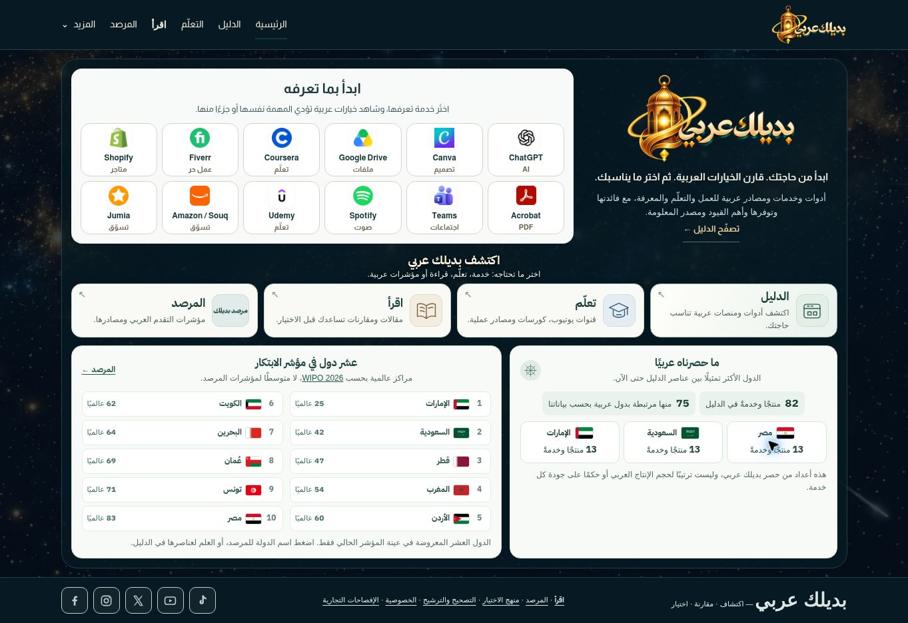
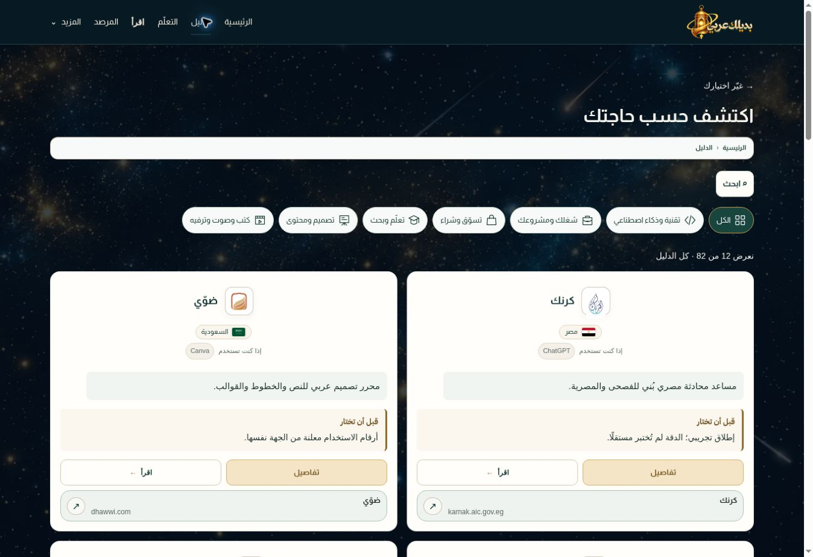

# Selective lab integration — 2026-10-15

## Scope and source of authority

The user's request was to carry only successful new additions from `https://badilak-lab.vercel.app/` onto the established main site, after reviewing the attached 2026-10-15 discussion. It was not authorization to replace main with the complete lab branch. The attachment contains both quoted user exchanges and assistant summaries; summaries were not treated as independent user approval.

- Main baseline: `18bebbf0bc1d1156f1e8fe13aa8dbc5dcc642ebb`.
- Lab source: `0fd5fefc822d9b34fbc520204e75a0a488593e75`, branch `lab-20261015`.
- Selective integration: `2d5e10c5fdc7edd6a6e91e6b3b2e0a92a76164d4`.
- Visual corrections after live inspection: `8144a6579f8d24674348aa1a082b74e6c44a3a43`.
- Production: <https://badilak-arabi.vercel.app/>.

## What was carried over and corrected

1. Four home destinations, a compact desktop layout, country inventory from existing records, and a separate sourced innovation panel. Categories remain available in the directory. Narrow screens retain normal scrolling.
2. Two wider directory columns on desktop and one on mobile, centered logo/name pairs, aligned action rows, batches of 12/8/6, and category controls on the page. Existing card summaries, caution sections, reading links and external choice dialog remain.
3. Limited discovery rotation on a fresh directory visit; the order stays stable during reading, filtering and browser-history restoration. Loading more retains earlier cards.
4. All learning groups and their existing cards are visible; redundant folding/carousel controls were removed. The existing wording was retained.
5. The approved review-section labels and five temporary social icons. The latter point to the homepage and are labelled as temporary; no social-account URLs were invented.
6. The innovation panel uses the official WIPO 2026 ranks. Country inventory and the innovation index remain separate; no composite score was introduced. The obsolete percentage presentation of categorical measures was removed without changing their categories.
7. Corrected the static directory renderer's callback argument, breadcrumb contrast on its light panel, and the desktop home fit after inspecting production.

Official source for the innovation panel: <https://www.wipo.int/web-publications/global-innovation-index-2026/en/gii-2026-results.html>.

## Protected layers

The integration audit verifies unchanged catalog data (82 services and 36 learning resources), detail rendering, card cautions, article files and reading hierarchy, commercial-link configuration, site/deployment indexing configuration, home promise/description, review-card content/statuses, and the three reserved advertisement examples. The approved logo and cosmic artwork were retained. The external destination choice function is unchanged. Discovery memory only gained the two lines required to save/restore rotation state.

Lab changes that rewrote existing card copy or dropped cautions were not transferred. The whole lab stylesheet was not copied.

## Verification completed

- Build passed: 82 service pages, 6 category pages and 20 articles.
- `scripts/audit-lab-integration.cjs` passed, including baseline preservation and the existing prelaunch audit of 113 generated HTML pages, local paths, canonical uniqueness, structured data and noindex settings.
- `scripts/audit-directory-rotation.cjs` passed: stable visit/filter/resize/reload behavior and storage fallback; later items receive exposure across seeds.
- `git diff --check` passed.
- Production Vercel deployment for `8144a65` reported `READY`.
- Desktop at 1363 × 936: document height 936, width 1363, footer ends at 936. The home fits this viewport without scrolling; this is not a claim about every screen size or zoom level.
- Directory: two columns, equal card heights within each inspected row, readable breadcrumbs, no horizontal overflow. More expands 12 to 24 while retaining the first 12.
- Directory → learning → browser Back restored the previous order. Fresh directory navigation changed only the intended discovery positions.
- Country selection, all four learning groups and all 36 learning resources were checked. The external destination button opened the choice dialog and cancel retained the page.
- Mobile screenshots: home routes and panels stack correctly; directory has one column and 6 initial results. Final resumed check confirmed the service logo and name are side by side, resolving the earlier screenshot concern without another code change.

Desktop evidence:

## Boundaries and remaining inputs

- Real social-profile URLs remain to be supplied; current destinations are intentional placeholders documented in the lab discussion.
- No new Core Web Vitals or PageSpeed score is claimed. Functional and viewport checks are not a substitute for field performance data.
- Search indexing remains disabled. No ads, analytics, paid dependency or hosting migration was activated.
- On the final resume, local main and origin/main were both `8144a65`; the four attached project source files were unchanged. No later runtime development required integration.
- The specifically named conversation «منهجية العمل arabi» was not available as an identifiable full transcript in the context search. Other retrieved snippets were not substituted for it.

## Resume record

The functional integration and production publication were already complete before this final resume. This resume checked the outstanding mobile identity concern and recorded the evidence; it did not repeat or redesign the implementation.
